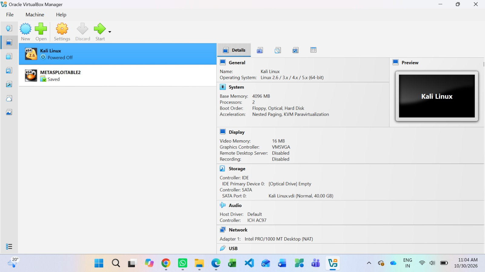
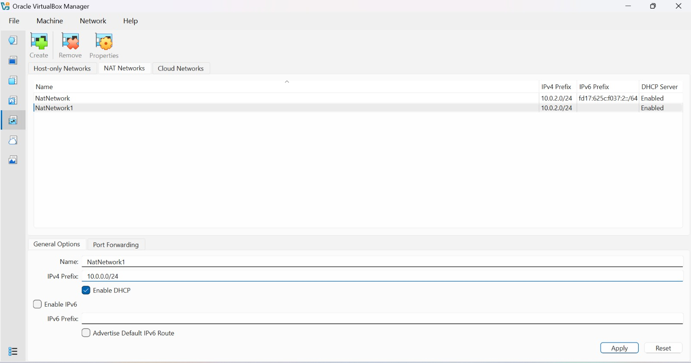
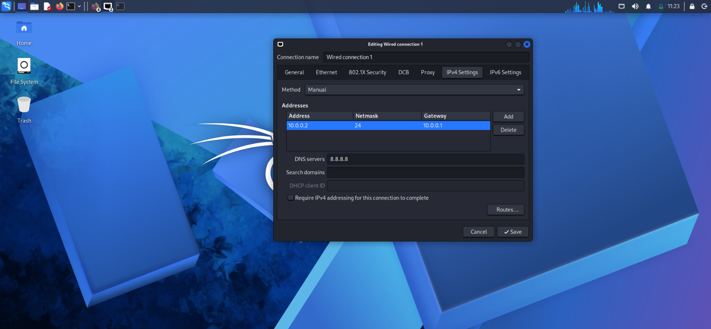

 🔐 **Cybersecurity Lab Setup**

 📌 **Introduction**

This repository contains my Cybersecurity Lab setup and configuration work using **Kali Linux** and **Oracle VirtualBox**.

The purpose of this lab is to create a controlled environment for learning cybersecurity concepts, Linux, networking, and security tools.

This repository contains screenshots and documentation of the lab setup process.

---

## 🎯 Objectives

The main objectives of this lab are:

- Set up Kali Linux in a virtual machine.
- Understand the Kali Linux environment.
- Configure and check network settings.
- Identify network interfaces and IP address information.
- Verify basic network connectivity.
- Document the lab setup using screenshots.
- Maintain the practical work using GitHub.

---

## 🛠️ Tools Used

- **Kali Linux**
- **Oracle VirtualBox**
- **Windows**
- **GitHub**
- **Linux Terminal**

---

## 🏗️ Lab Environment

Kali Linux is configured as a virtual machine using Oracle VirtualBox.

The virtual machine provides a controlled environment for performing cybersecurity and networking practical exercises without directly affecting the host system.

---

## 🪜 Lab Setup and Configuration

### 1. Lab Setup Title

The first screenshot represents the beginning of the Cybersecurity Lab setup.


---

### 2. Network Settings

The network settings of the Kali Linux virtual machine were checked and configured as required for the lab environment.



---

### 3. Kali Linux Environment

The Kali Linux desktop environment was opened and verified successfully after starting the virtual machine.

`

---

### 4. Kali Linux Network Settings

The network configuration of Kali Linux was checked to verify the available network connection and settings.



---

## 💻 Basic Linux Networking Commands

The following commands can be used to check and understand the network configuration in Kali Linux.

### Check IP address

```bash
ip addr
```

This command displays the IP addresses assigned to the network interfaces.

### Check network interfaces

```bash
ip link
```

This command displays the available network interfaces and their current status.

### Check routing information

```bash
ip route
```

This command displays the routing table of the system.

### Test network connectivity

```bash
ping -c 4 google.com
```

This command can be used to check whether the system can communicate with an external network.

---

## 📸 Lab Evidence

The repository contains the following screenshots:

| No. | Screenshot | Description |
|---|---|---|
| 1 | `1-screenshot-title-image.png` | Lab setup title |
| 2 | `2-screenshot-network-settings-1.png` | Network settings |
| 3 | `3-screenshot-kali-linux.png` | Kali Linux environment |
| 4 | `4-screenshot-kali-network-settings.png` | Kali Linux network settings |

---

## 🧠 Learning Outcomes

After completing this lab, I learned:

- How to work with Kali Linux in VirtualBox.
- How to access Kali Linux network settings.
- How to identify network interfaces.
- How to check IP address information.
- How to use basic Linux networking commands.
- How to document cybersecurity practical work using GitHub.

---

## 🔐 Ethical Use

This laboratory environment is intended only for **educational and authorized cybersecurity practice**.

Security testing should only be performed on systems that I own or have explicit permission to test.

---

## 👤 Author

**Prince Kumar**

**MCA – Computer Networking and Cyber Security**  
Galgotias University  
Batch: **2025–2027**

---

## 📚 Lab Information

**Lab:** Cybersecurity Lab Setup  
**Week:** 01  
**Platform:** Kali Linux  
**Virtualization:** Oracle VirtualBox  
**Repository:** GitHub
